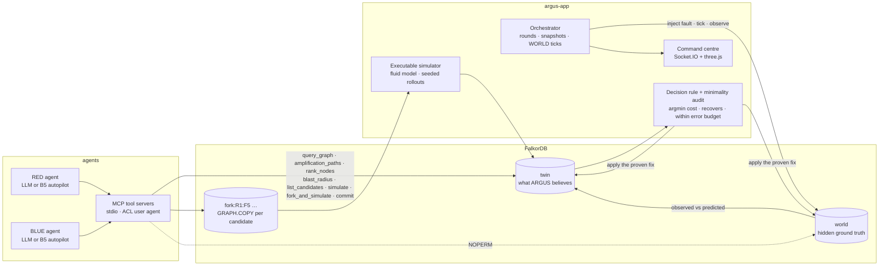
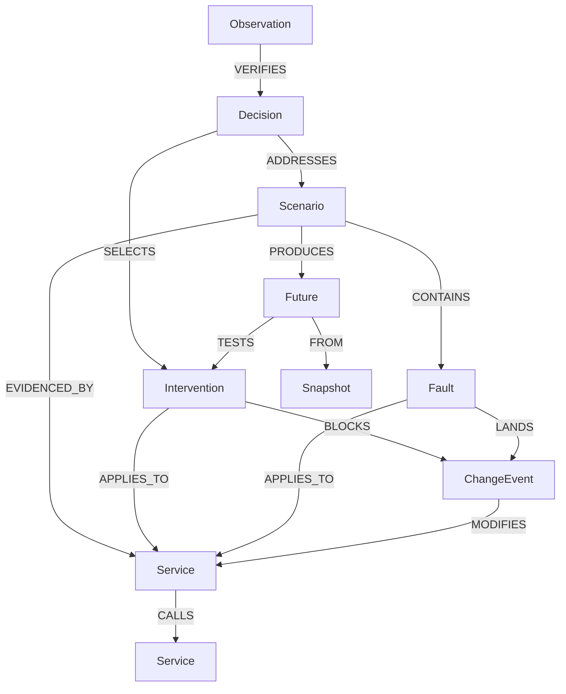

# ARGUS

**Find the outage before it happens. Prove the smallest fix. Check the prediction against reality.**

ARGUS is a graph-grounded RED / BLUE agent that attacks a copy of your system in FalkorDB, tests candidate fixes on forked graphs, and only applies a fix the server can prove is the cheapest safe one in scope.

Display note: For the best experience, open the live demo in Google Chrome with the browser maximized or full-screen. The interface is designed for a full-width desktop window and may not display correctly when Chrome is snapped to half the screen or used in a narrow window.

| | |
|---|---|
| **Live demo** | https://argus-graphhack.onrender.com (free tier: the first request can take about a minute to wake) |
| **Health** | https://argus-graphhack.onrender.com/state |
| **Repository** | https://github.com/rahilahmed-1945/ARGUS-GraphHack |
| **Hackathon** | [Graph Hacks: Context for AI Agents](https://www.wemakedevs.org/hackathons/falkordb) by WeMakeDevs × FalkorDB, 15–18 Oct 2026. **Track 01: Agents That Act on Connected Data.** |
| **Demo video** | https://youtu.be/056j4MI525c |
| **Project Blog** | https://medium.com/@rahilahmed1305/i-built-argus-an-ai-agent-that-doesnt-just-suggest-fixes-it-has-to-prove-them-88d406feff63 |
---

# Run ARGUS Yourself — Bring Your Own API Key

Judges have two ways to explore ARGUS:

- **Hosted public demo** at https://argus-graphhack.onrender.com. A stable, repeatable replay of a genuine live run; no API key, no setup. Every graph query, fork, simulation, audit and world tick executes on the server when you press start; only the agents' recorded decisions are replayed, and the UI says so.
- **Local live mode** with your own OpenRouter API key. Clone the repository, start FalkorDB, put your key and a model id in `argus/.env`, and run the same system with RED and BLUE driven by a real model. The full walkthrough is the [Local Setup and Judge Testing Guide](#local-setup-and-judge-testing-guide) at the end of this file.

### AI-first architecture with deterministic reliability

ARGUS is built to let AI agents do the investigation and the recovery proposal. With a valid `OPENROUTER_API_KEY` and an `ARGUS_LLM_MODEL` that supports tool calling, RED and BLUE are LLM agents: the model chooses which graph tools to call (Cypher queries, the amplifier-path query, PageRank, blast radius, candidate listing), which fault sets to simulate, which interventions to fork and test, and what to commit. Every call goes through MCP to a server that validates it, charges the budget, executes it on FalkorDB and records it.

**The deterministic B5 autopilot is the reliability layer, not the primary decision-maker.** It drives the same tools and is subject to the same decision rule and minimality audit, and it takes over a phase only under the conditions implemented in `argus/runtime/runtime.js`:

| Takeover reason (as labelled in the UI, `/state` and the recorded cassette) | Trigger |
|---|---|
| `llm_error` | The provider returned an error (HTTP error such as an unknown model or a rate limit, a network failure) |
| `turn_ceiling` | One model turn took longer than the ceiling (default 6 000 ms; `--ceiling-ms` raises it) |
| `consecutive_rejects` | Two consecutive tool calls were rejected or unusable (unparseable arguments, out-of-scope ids, empty replies) |
| `no_progress` | Four `simulate` (RED) or `fork_and_simulate` (BLUE) calls without a qualifying result |
| `max_turn` | Turn 8 of the phase arrived without a commit |
| `budget_exhausted` | The agent spent its tool, simulation or fork budget for the round |
| `mcp_unavailable`, `tool_failure` | The MCP tool server could not start, or the database or driver failed mid-phase |
| `cassette_miss` | Replay only: the cassette holds no decision for this turn |
| `llm_unavailable` | No model is configured (autopilot mode) |

So B5 does not activate only when an API call fails: a model that is slow, stuck, or wandering is also handed over, and the phase is labelled `autopilot (<reason>)`. Nothing in live mode guarantees that every phase is model-decided, and a completed run never proves it either. Check the provenance: the engine badge, the provenance line under the stage, the `phases` field of `/state` after a run, and the `provenance` block of the cassette the run records.

The hosted demo replays a recorded execution for a stable demonstration; its recorded LLM decisions remain recorded decisions. Running locally in live mode is how to test model-dependent behaviour yourself, subject to provider availability, model limits, latency and your account's usage costs.

### Mode comparison

| Feature | Hosted public demo | Local replay | Local live mode |
|---|---|---|---|
| API key | Not required (live runs on the hosted instance are operator-only) | Not required; only the two FalkorDB passwords that `npm run db:up` generates | Required: `OPENROUTER_API_KEY` and `ARGUS_LLM_MODEL` in `argus/.env` |
| Execution | The runtime, graph forks, simulations, audits and world ticks run live on the server; agent decisions come from `cassettes/public-live-replay.json` | Same mechanism. Default cassette: `reference-scripted.json`, a recording of the deterministic scripted reference models (labelled "not a real LLM recording"); pass `--cassette cassettes/public-live-replay.json` for the recorded live run | Real OpenRouter requests at temperature 0 with tool calling, paced at one request per 4.5 s by default; the run is recorded to a new cassette with provenance |
| New LLM decisions | None: no model is called | None: no model is called | Yes, for every phase until a takeover, if any |
| Deterministic B5 fallback | Shown where the recorded run took over: in the public cassette, three of four phases (`max_turn`, `no_progress`, `turn_ceiling`); the fourth (round-2 RED) was model-decided | Where the cassette took over, plus `cassette_miss` when the cassette has no decision for a turn | Takes over on the implemented conditions above; its calls are labelled `b5` / `autopilot` |
| Custom testing | GUIDED DEMO, CONTROL THE SYSTEM (your choice of configuration, run by the scripted reference models, labelled `INTERACTIVE (scripted)`), Run again, Reset; one run start per visitor per 15 s | Everything the hosted demo offers, plus any cassette, `--mode autopilot` (B5 only), the terminal demo and the test suites | Live runs with your model, `--ceiling-ms`, `--record` to keep the cassette, then replay your own recording. CONTROL THE SYSTEM is refused in live mode (the scripted models are never mixed into a live session) |
| Provenance | Provenance line and `/state.source`: `cassette · live OpenRouter run (UI) · R1 RED b5 (max_turn) · R1 BLUE b5 (no_progress) · R2 RED llm · R2 BLUE b5 (turn_ceiling)` | The cassette's own provenance, shown the same way | Badge `LIVE LLM`; provenance line with provider, model, ceiling and each phase's `llm` or `autopilot (<reason>)`; `/state` fields `live`, `model`, `ceilingMs`, `phases`, `cassette`; `by: "llm"` or `"b5"` on every tool call in the event stream |

### OpenRouter and model configuration

- You supply your own OpenRouter API key (https://openrouter.ai, Keys). ARGUS reads it from `OPENROUTER_API_KEY` and never prints it, stores it in a cassette, or sends it to the browser.
- `ARGUS_LLM_MODEL` must be a model id available to your account that supports tool calling (the id as shown on https://openrouter.ai/models, for example a `vendor/model` string). ARGUS has no default model: if the variable is missing, live mode refuses to start with a clear message instead of guessing.
- Availability, latency, rate limits and charges depend on the model and OpenRouter's terms. Free routes have per-minute and per-day caps and can be slow; ARGUS paces requests (4.5 s apart by default, `ARGUS_LLM_MIN_INTERVAL_MS` overrides) and never retries a failed request.
- Never share the key or commit it: `argus/.gitignore` ignores `.env`, and the Docker image excludes it.
- A slow, erroring or stuck model hands the phase to B5 under the conditions listed above. A successful run therefore does not prove every decision was generated by the model; inspect the provenance.

## 1. What if you could find an outage before it happens?

A service slows down. The services that call it retry their requests. Those retries multiply traffic across the system, and one small problem turns into a cascading outage. And the service that *looks* broken is often not the service that *started* it.

Here is the situation ARGUS is built around. Picture an online shop with eight services. For thirty seconds, the ledger database gets slow. Payments, which writes to it, starts timing out. Checkout retries each failed payment three times. The gateway retries each failed checkout twice. Nobody changed anything; this is ordinary, sensible retry configuration.

```
300 requests/s  ×  (1 + 2 retries)  ×  (1 + 3 retries)  =  3,600 attempts/s
against a payments service that can really handle about 704/s
```

Then the database recovers. **The outage does not.** The retries are now the load. Every dashboard points at `payments`, the service that is visibly saturated, but scaling it does nothing and fixing the database did nothing. The trigger was three hops below the users and one hop below the real amplifier. That is a *metastable failure*, and it is exactly the kind of thing a graph can see and a dashboard cannot.

ARGUS searches for dangerous failure combinations like this one **before they happen**, tests the possible fixes on copies of the system, chooses one by a rule it can explain, and then checks whether the fix actually worked.

## 2. What ARGUS does: RED → BLUE → VERIFY

- **RED finds trouble.** A budgeted agent reads the system graph, follows the multi-hop retry path that amplifies load, pairs it with a trigger underneath it, and proves the attack in simulation on a scratch copy. It is not allowed to invent faults: it can only pick from the failure modes the graph generated.
- **BLUE finds a fix.** After the attack, BLUE snapshots the live state, forks the graph once per candidate fix with `GRAPH.COPY`, and runs seeded simulations on each fork. Every candidate comes from the graph, scoped by the server to the paths the fault can actually affect.
- **ARGUS verifies.** A server-side rule, not the model, commits the cheapest future that recovers and stays inside the error budget. The server then audits every untested in-scope option at the same or lower cost. The fix is written to the twin and to a separate hidden WORLD graph, and the twin's prediction is compared with what the world actually did.
- **Then it attacks again.** The hardened system is a different graph, so the second attack has to reason differently. In the recorded run, the retry-storm query comes back empty and the agent pivots to the pending deployment that would turn a routine slowdown into a permanent outage.

## 3. The four stages, as they look in the running UI

All images are unedited captures of the ARGUS command centre replaying the recorded live run (the same recording the public deployment serves).


*Stage 1, the command centre. The twin graph holds every service, every call edge with its retry, timeout and breaker settings, the generated faults and interventions, and the round's budgets and safety constants.*


*Stage 2, RED finds the failure. The multi-hop amplifier query reports a 4.5× worst-case load along gateway → checkout → payments. RED then simulates the triggers beneath it: a payments slowdown heals by itself (0 of 16 runs broken) while a ledger-db slowdown, three hops from the users, breaks the system in 15 of 16 runs.*


*Stage 3, BLUE tests fixes on forks. Doing nothing, adding ledger-db capacity, limiting or disabling a single retry layer: all still broken. Two circuit breakers recover but blow the error budget. Disabling retries on both amplifier layers recovers in all 16 runs with few bad ticks.*


*Stage 4, the server verifies. BLUE proposed the fix; the rule accepted it; the audit then ran the 10 untested in-scope options at the same or lower cost as real forked futures. None qualifies, so the decision is recorded as proven-in-scope.*


*The prediction is checked against the hidden WORLD graph: the twin predicted a median of 2 bad ticks, the world showed 3, inside the predicted p10–p90 band. The twin also recalibrates the payments capacity it had wrong.*

## 4. Why FalkorDB is the centre of the system, not a store behind a chart

Any database could be forced to do each of these jobs. The point is that **one graph is at once the model, the action space, the fork substrate, the algorithm engine, the safety constraint, the access boundary and the trace.**

| What the graph does | How |
|---|---|
| **It is the model** | The simulator has no topology or constants of its own. Its only input is `loadModel(graph)`. Every capacity, retry count, timeout, breaker setting and fault magnitude is a node or edge property. |
| **It generates the action space** | Faults and interventions are not hard-coded lists. Cypher rules run over the topology (`graph/schema.js`) and create a `Fault` node for every non-entry service, entry service and pending deploy, and an `Intervention` node for every retrying edge, breaker-less edge, service and pending deploy. After hardening the rules run again, so the hardened graph offers different moves. |
| **It is the fork substrate** | Every counterfactual future is a real `GRAPH.COPY` of the twin, named `fork:R<round>:<label>`, mutated by a fixed Cypher template, simulated, summarised as a `Future` node on the twin, then deleted. |
| **It is the evidence engine** | The amplifier path (variable-length path plus `reduce` over retries, fan-out and capacity), the downstream closure that finds triggers, `algo.pageRank`, and the blast-radius traversal are the tools the agents call. |
| **It holds the safety constraint** | `error_budget`, `rec_threshold`, the SLO and the simulation horizons live on the `Round` node. The decision rule reads them from the graph. |
| **It enforces the WORLD / TWIN boundary** | The agents' MCP servers connect as a Redis ACL user that can only touch `twin`, `fork:*` and `argus:*`. The hidden `world` graph answers `NOPERM`. The prediction claim is honest because the database enforces it. |
| **It is the shared state and the trace** | Budgets (`Charge`), scenarios, futures, decisions, observations and every tool call (`Step`, with its Cypher) are graph records. The MCP child processes coordinate only through FalkorDB. |

Remove the graph and there is nothing to simulate, nothing valid to choose from, nothing to fork and nothing to audit.

## 5. What is genuinely different about ARGUS

None of the individual algorithms here is new. PageRank, variable-length path queries and Monte Carlo rollouts are standard. What is unusual is how the pieces are arranged.

- **RED finds trouble from the graph.** It discovers fault *combinations* and traces multi-hop amplification, rather than picking a random service to kill. In the recording it pairs a slowdown with a pending deployment that only becomes dangerous together.
- **BLUE finds a fix by testing futures, not by guessing.** Each candidate runs on its own graph fork with 16 seeded rollouts, and the twin keeps the predicted band for later comparison.
- **FalkorDB drives the reasoning.** The topology, the candidate faults, the valid interventions, the scope of a decision and the forks all come from Cypher over the live graph (section 4).
- **The LLM is not the final authority.** The model chooses what to look at and what to test, inside a tool budget. The server decides what is valid (candidate scope, at most two interventions, no conflicting edits), charges the budget, applies the decision rule and runs the minimality audit. A proposal that the rule rejects is refused with a reason.
- **The system checks its own predictions.** A separate WORLD graph, with capacities the twin does not know, plays the role of production. Every decision gets an `Observation` node with predicted and observed bad ticks, and the twin recalibrates from what it saw.
- **It learns what to investigate next.** Round 2 runs on the hardened graph. The amplifier query returns nothing, so the agent has to switch tools (PageRank, then a pending-deploy query) to find the next weakness. The second screenshot below is that moment.


*Round 2 on the hardened graph. In the recorded run this RED phase was decided by the live model: it found that the pending deploy CE-42 (orders → ledger-db, retries 0 → 3) turns a slowdown that now heals on its own (0 of 16) into a permanent outage (16 of 16).*

## 6. How it works



One round, step by step:

1. **Seed.** `config/topology.yaml` is ingested into `twin` and `world` (the world differs only in a few hidden values, such as the real payments capacity). The action-space rules generate `Fault` and `Intervention` nodes.
2. **RED.** The agent calls graph tools over MCP, simulates candidate fault sets on a scratch copy, and commits a scenario. The server re-simulates it with the same seeds and audits that no cheaper attack exists.
3. **Inject.** The orchestrator applies the fault to `world` and advances it tick by tick. At tick 30 the trigger is removed. The world stays broken.
4. **Snapshot and BLUE.** A noisy estimate of the world's live state is written onto the twin. BLUE forks the twin per candidate, applies the fixed intervention template on the fork, runs 16 rollouts from the snapshot, and proposes the future it believes is best.
5. **Commit.** The rule picks the cheapest future with `p_recover ≥ 15/16`, median bad ticks `≤ 10` and no harm to any entry point compared with doing nothing. The audit runs every untested in-scope candidate at the same or lower cost. Only a proposal that equals the rule's winner is accepted.
6. **Harden and observe.** The intervention is applied to twin and world, a YAML config diff is generated from the actual graph change, the world runs on, and an `Observation` records predicted versus observed. The twin calibrates capacities it had wrong.
7. **Round 2.** The rules regenerate the action space on the hardened graph and RED attacks again.

If the model is slow, stuck or invalid, a deterministic autopilot (B5) takes over the phase using the same tools, and the UI labels that phase `autopilot` with the reason. The decision rule and audit apply to the autopilot exactly as they apply to the model.

## 7. Graph data model and real Cypher

### Nodes

| Label | Created by | Key properties |
|---|---|---|
| `Service` | seed | `name`, `entry`, `ext_rps`, `cap_mean`, `cap_sd`, `base_ms`, `queue_s`, `shed` |
| `ChangeEvent` | seed | `id`, `field`, `new_value`, `status` (`pending` / `blocked` / `landed`) |
| `Fault` | action-space rules | `id`, `kind` (`cap_degrade`, `surge`, `deploy`), `magnitude`, `persistence`, `cost_to_attacker`, `active` |
| `Intervention` | action-space rules | `id`, `kind` (`retries_off`, `cap_retries`, `breaker`, `scale_out`, `shed`, `block_deploy`), `caller`, `callee`, `cost`, `factor`, `active` |
| `Round` | seed | `n`, `sim_budget`, `fork_budget`, `red_tool_budget`, `blue_tool_budget`, `error_budget`, `rec_threshold`, SLO and horizon constants |
| `Scenario`, `Snapshot`, `Future`, `Decision`, `Observation`, `Step`, `Charge` | the run | scenario faults and server-computed `scope_ids`; live-state snapshot; per-future `p_recover`, `viol_ticks_p50`, `p10`/`p90`, `bands`, `verdict`, `cost`; the committed decision with its rule and audit counts; predicted vs observed; every tool call with its Cypher; idempotent budget charges |

### Relationships

`(:Service)-[:CALLS {fanout, retries, timeout_ms, breaker, …}]->(:Service)` · `(:ChangeEvent)-[:MODIFIES {callee}]->(:Service)` · `(:Fault|:Intervention)-[:APPLIES_TO]->(:Service)` · `(:Fault)-[:LANDS]->(:ChangeEvent)` · `(:Intervention)-[:BLOCKS]->(:ChangeEvent)` · `(:Scenario)-[:CONTAINS]->(:Fault)` · `(:Scenario)-[:EVIDENCED_BY]->(:Service)` · `(:Scenario)-[:PRODUCES]->(:Future)` · `(:Future)-[:TESTS]->(:Intervention)` · `(:Future)-[:FROM]->(:Snapshot)` · `(:Decision)-[:ADDRESSES]->(:Scenario)` · `(:Decision)-[:SELECTS]->(:Intervention)` · `(:Observation)-[:VERIFIES]->(:Decision)` · `(:Step)-[:TOUCHED]->(:Service)` · `(:Step)-[:NEXT]->(:Step)` · `(:Decision)-[:BASED_ON]->(:Step)`

After the seed the twin holds 8 `Service`, 9 `CALLS`, 2 `ChangeEvent`, 10 `Fault` and 27 `Intervention` nodes. The full schema is in [docs/ARGUS_FINAL_ARCHITECTURE.md](docs/ARGUS_FINAL_ARCHITECTURE.md) §5.


### Graph schema at a glance



**How the agent uses the graph:** RED queries service-call paths and fault evidence to discover risky failure scenarios. BLUE evaluates candidate interventions against graph-derived state using counterfactual graph forks. The server audits the selected intervention, records the decision, and checks the predicted outcome against observations from the separate simulated WORLD graph.

### Cypher the product depends on

All five queries below were executed against the seeded twin on FalkorDB 6.0.1 while writing this README; the results quoted are what they returned.

**The amplifier query** (`amplification_paths`, `runtime/tools.js`). It follows every path from an entry point up to five hops, multiplies the worst-case load along it, bounds the load by each hop's capacity, and then looks *beneath* the overloaded service for the faults that could trigger the storm.

```cypher
MATCH p = (e:Service {entry:true})-[:CALLS*1..5]->(s:Service)
WITH p, e, s, nodes(p) AS ns, relationships(p) AS rs
WITH p, s, reduce(L = toFloat(e.ext_rps), i IN range(0, size(rs)-1) |
       (CASE WHEN L > ns[i].cap_mean THEN ns[i].cap_mean ELSE L END)
       * rs[i].fanout
       * (CASE WHEN rs[i].breaker THEN 1 ELSE 1 + rs[i].retries END)
     ) AS worst_load
WITH p, s, worst_load / s.cap_mean AS overload
WHERE overload >= $min_risk
MATCH q = (s)-[:CALLS*0..4]->(d:Service)<-[:APPLIES_TO]-(f:Fault) WHERE coalesce(f.active, true)
WITH p, s, overload, f, min(length(q)) - 1 AS hops
ORDER BY overload DESC, hops, f.id
RETURN [n IN nodes(p) | n.name] AS amplifier, s.name AS target, overload,
       collect(f.id + '@' + toString(hops)) AS triggers
ORDER BY overload DESC, target, amplifier
LIMIT 5
```

Result on the seed with `min_risk = 2`: one row, amplifier `gateway → checkout → payments`, overload `4.5`, triggers `degrade:payments@0`, `degrade:ledger-db@1`. On the hardened graph the same query returns no rows, which is what forces the agent to change tools in round 2.

**PageRank as a tool** (`rank_nodes`):

```cypher
CALL algo.pageRank('Service', 'CALLS') YIELD node, score
RETURN node.name AS service, score ORDER BY score DESC, service
```

Result: `ledger-db 0.220`, `inventory 0.164`, `auth 0.137`, `payments 0.119`, then checkout and orders.

**Pending deployments into the top-ranked service** (the round-2 pivot, written by the agent through `query_graph`):

```cypher
MATCH (c:ChangeEvent {status:'pending'})-[m:MODIFIES]->(a:Service)-[:CALLS]->(b:Service {name:'ledger-db'})
WHERE m.callee = b.name
RETURN c.id, a.name, b.name ORDER BY c.id
```

Result: `CE-42, orders, ledger-db`.

**Blast radius** (`blast_radius`), everything upstream of a service with hop counts:

```cypher
MATCH p = (u:Service)-[:CALLS*1..6]->(x:Service {name:$service})
WITH u, min(length(p)) AS hops
RETURN u.name AS upstream, u.entry AS is_entry, hops ORDER BY hops, upstream
```

Result for `ledger-db`: orders and payments at 1 hop, checkout and mobile-gw at 2, gateway at 3.

**Scope, computed by the server and never by the agent** (`graph/scope.js`, first of three queries). It collects every entry-to-fault path, so BLUE can only test interventions on paths the fault can actually affect:

```cypher
MATCH (:Scenario {id:$id})-[:CONTAINS]->(:Fault)-[:APPLIES_TO]->(t:Service)
MATCH p = (e:Service {entry:true})-[:CALLS*0..6]->(t)
RETURN [n IN nodes(p) | n.name] AS ns,
       [r IN relationships(p) | startNode(r).name+'>'+endNode(r).name] AS es
```

**A counterfactual, written on the fork only** (`graph/forks.js`, the `retries_off` template; the value comes from the `Intervention` node, never from code):

```cypher
MATCH (i:Intervention {id:$id})
MATCH (a:Service)-[c:CALLS]->(b:Service) WHERE a.name = i.caller AND b.name = i.callee
SET c.retries = 0 RETURN count(c) AS n
```

## 8. Technology stack and algorithms

| Component | Choice | Why |
|---|---|---|
| Graph database | **FalkorDB 6.0.1** (pinned Docker image), `falkordb` 6.8.0 and `redis` 5.12.1 Node clients | Cypher, `GRAPH.COPY` for forks, `algo.pageRank`, Redis ACL for the WORLD/TWIN boundary |
| Runtime | **Node.js 22**, ES modules, `node:test` | One language from graph layer to UI; built-in test runner |
| Agent tools | **Model Context Protocol** (`@modelcontextprotocol/sdk` 1.32.1), one stdio server per role | The model sees only its role's tools; every call goes through the server's authorisation, budget and `Step` trace |
| LLM | **OpenRouter**, OpenAI-compatible chat completions with tool calling, temperature 0 | Provider-agnostic; the recorded run used `cohere/north-mini-code:free` |
| Fallback agent | **B5 deterministic autopilot** | Same tools, no model; keeps the demo honest and reliable when a free model stalls |
| Simulator | Fluid (rate-based) model of queues, timeouts, retries and breakers; `mulberry32` PRNG with Box–Muller noise | Bit-identical to a frozen Python reference (`sim/reference`); 16 seeded rollouts per future with common random numbers |
| Command centre | Socket.IO 4.8 + three.js 0.186 | Replays the real event log with narration; every evidence line opens the Cypher behind it |
| Deployment | Single Docker image (FalkorDB + Node) on Render Free | ₹0, no persistent state needed |

Algorithms, each of which changes what an agent does:

- **Amplifier-path discovery**: variable-length path with a `reduce` over retries, fan-out and capacity (the retry-storm inequality, evaluated per path).
- **Downstream closure**: `*0..4` traversal beneath the overloaded service to list the faults that can light it.
- **PageRank** over `CALLS`: the fallback evidence when no amplifier exists.
- **Blast radius**: upstream BFS with minimum hop counts.
- **Counterfactual forks**: delete-then-`GRAPH.COPY`, fixed intervention templates, seeded Monte Carlo rollouts.
- **Decision rule**: `argmin cost | p_recover ≥ rec_threshold AND viol_ticks_p50 ≤ error_budget AND not harmful`, ties broken by median bad ticks then id.
- **Scoped minimality audit**: every untested in-scope candidate (do nothing, every single, every non-conflicting pair) at cost ≤ the committed cost is simulated on a real fork before the decision is recorded.
- **Calibration**: capacities re-estimated from clean saturated world ticks, with a 3 % uncertainty floor.

## 9. Quick start (tested on Windows 11 with Docker Desktop, Node 22)

The step-by-step version for judges, with environment variables, live mode, a testing checklist and troubleshooting, is the [Local Setup and Judge Testing Guide](#local-setup-and-judge-testing-guide) at the end.

Prerequisites: Node.js 22.9 or newer, Docker with Compose v2.

```bash
cd argus
npm ci
npm run db:up      # generates argus/.env with random database secrets, starts FalkorDB 6.0.1, bootstraps the ACL
npm run ui         # command centre at http://127.0.0.1:4173 (replay of the scripted reference run)
```

To replay the recorded live run that the public deployment serves:

```bash
npm run ui -- --cassette cassettes/public-live-replay.json
```

Other commands:

```bash
npm run demo                      # the full run in the terminal, with the event log
npm test                          # 203 tests across graph, simulator, forks, decision rule, agents, MCP, UI and deployment (needs db:up)
npm run test:ai                   # offline agent tests against a mock OpenRouter endpoint (no network)
npm run test:ai:e2e               # one end-to-end run through the real MCP transport
npm run reset                     # delete every graph and reseed from config/topology.yaml
npm run db:down
```

Live mode with a real model: put `OPENROUTER_API_KEY` and `ARGUS_LLM_MODEL` in `argus/.env` (see `.env.example`), then run `npm run ui:live -- --ceiling-ms 30000`. The engine badge reads `LIVE LLM`, and the provenance line names which phases the model decided and where the autopilot took over.

## 10. Public demo and what it does and does not do

The public deployment runs the **same code, graph, simulator, decision rule, audit and ACL boundary** as the local demo, inside one container on Render's free tier.

- **Default mode is replay, and it says so.** The engine badge reads `REPLAY`. Every query, graph copy, simulation, audit and graph write executes live on the server when you press start; only the *agent's decisions* are replayed from a recording. No numbers are replayed.
- **The recording is a genuine live run** made on 17 Oct 2026 with `cohere/north-mini-code:free` over OpenRouter. Its provenance line is shown in the UI: `R1 RED autopilot (max_turn) · R1 BLUE autopilot (no_progress) · R2 RED llm · R2 BLUE autopilot (turn_ceiling)`. In plain words: the model decided the round-2 attack on its own; in the other three phases the free model ran out of turns, made no progress, or exceeded the 30-second turn ceiling, and the deterministic autopilot finished the phase with the same tools. Each phase in the UI is labelled accordingly.
- **Three kinds of decision, always distinguished:** *replayed* agent decisions (from the cassette), *fresh LLM* decisions (only in live mode, labelled `llm`), and *B5 autopilot* decisions (labelled `autopilot` with the takeover reason). Replay is never presented as live AI activity.
- **"Control the system"** lets you change the graph (keep or disable the gateway → checkout retries) and watch ARGUS attack the changed graph. That mode runs the deterministic reference models live and is labelled `INTERACTIVE (scripted)`, not an LLM.
- **Live LLM runs on the public instance are operator-only.** Anonymous visitors cannot trigger them: a server-side operator token is required, run starts are rate-limited per visitor (15 s cooldown), and live runs are capped per day because the free model quota is shared. The OpenRouter key never leaves the server.
- **Free-tier behaviour.** The instance sleeps after 15 minutes without traffic. Waking takes about a minute, then FalkorDB starts and the graph is reseeded (about 35 s more on 0.1 CPU). A full replay takes roughly 75 seconds of server time at that CPU share. The deployment recipe, variables and rollback steps are in [docs/DEPLOY_RENDER.md](docs/DEPLOY_RENDER.md).


*The end of the recorded run: both attacks found, both fixes proven and applied, and the live system stays green through the second attack even though the risky deploy CE-42 really lands.*

## 11. How ARGUS differs from IncidentMind

IncidentMind is an earlier project by the same author: an incident-response assistant that reconstructs *past* incidents from deployments, commits, alerts and chat, attributes root causes, and recommends recovery actions. ARGUS is new work built for Graph Hacks, and it answers a different question.

| | IncidentMind | ARGUS |
|---|---|---|
| Question | "What happened, and how do we recover?" | "How could this system fail next, and what is the smallest intervention that prevents it?" |
| When it runs | After an incident | Before one, continuously (attack, harden, attack again) |
| Evidence | Telemetry, alerts, commits, Slack | A FalkorDB graph of the system's real configuration |
| Agents | One analyst over documents and RAG | Adversarial RED and BLUE over graph tools, with a deterministic fallback |
| Output | A briefing and a recommendation | A proven-in-scope fix applied to the graph, a config diff, and a predicted-vs-observed record |
| Verification | None (advice) | A hidden WORLD graph the agent cannot read; the fix is checked against it |
| Graph database | None | FalkorDB is the model, the action space, the forks, the constraint and the trace |

No IncidentMind code is reused.

## 12. Honest limitations and AI-assistance disclosure

- **Scoped, not global, minimality.** "Proven" means: among every intervention set of at most two interventions, drawn from the server-computed scope of this scenario, at cost ≤ the committed cost, none satisfies the rule and is cheaper. It is not a proof over every conceivable change to the system.
- **The world is simulated.** The WORLD graph is a second FalkorDB graph driven by the same fluid simulator with hidden parameter differences, not a real production system. The predicted-versus-observed comparison is real; the world is not.
- **One failure class, eight services.** ARGUS models the retry-storm (metastable) failure over `cap_degrade`, `surge` and `deploy` faults on a fixed eight-service topology. Connection-pool pressure, queue-depth limits and other mechanisms are not modelled.
- **Free LLMs are unreliable.** In the recorded run the model decided one phase of four. The autopilot takes over when a model is slow or stuck, and the UI says so; nothing is hidden, but not every phase is model-decided.
- **Tool budgets are small by design.** 14 tool calls and 6 simulations or forks per role per round. That keeps the demo under four minutes; it also limits how far an agent can explore.
- **Numbers.** Every figure in this README (4.5×, 15 of 16, 16 of 16, 2 predicted versus 3 observed, 10 and 12 audited options) is read from the recorded run and the seeded graph, and can be reproduced with `npm run demo`. No benchmark or user study is claimed.
- **AI assistance.** AI coding assistants (Claude Code) were used during the hackathon for implementation, tests, documentation and this README, directed and reviewed by the author, who can explain the graph model, the queries, the architecture and the technical decisions. All graph modelling, decision-rule and verification design decisions are documented in `docs/ARGUS_FINAL_ARCHITECTURE.md`.

## 13. Future scope

- **Real telemetry in, config PRs out.** Ingest service-mesh configuration and traces to build the twin, and open the generated YAML diff as a pull request against the real mesh config.
- **More failure mechanisms.** Connection-pool exhaustion, queue-depth limits, cache stampedes and dependency fan-in, each as a graph-generated fault kind with its own rule.
- **Larger topologies.** Scope computation and the audit are designed to stay tractable because they are bounded by graph paths; the next step is measuring that on 50 to 200 services.
- **Research baselines.** The architecture defines B0 to B6 baselines and a scoped oracle; B0, B5 and the oracle exist today. Comparing an LLM agent with the deterministic policy across seeds is planned follow-up work.
- **Stronger live-model reliability.** Longer turn ceilings, paid models and parallel candidate evaluation so that every phase can be model-decided within the demo slot.
- **Explainability.** A "Why?" shortest-path explanation from entry point to trigger, and clickable raw rollouts behind every future.

## 14. Demo video

Coming soon. The link will be added here once the recording exists.

## 15. What works, what to expect, and current limitations

### Verified graph and simulator behaviour (covered by the test suites: 203 tests in `npm test`, 21 in `npm run test:ai`, 1 end-to-end)

- The twin and world graphs are built from `argus/config/topology.yaml`: 8 services, 9 `CALLS` edges with retry, timeout and breaker settings, 2 pending change events. The action spaces (10 faults, 27 interventions) are generated by Cypher rules and regenerated after every hardening.
- The amplifier-path query, PageRank, blast radius and scope queries run on FalkorDB and return the values quoted in section 7.
- Every counterfactual future is a real `GRAPH.COPY` fork of the twin, mutated by a fixed template and simulated with 16 seeded rollouts; the summary is written back as a `Future` node and the fork is deleted.
- The decision rule (`argmin cost | p_recover ≥ 15/16 AND median bad ticks ≤ 10 AND not harmful`) and the minimality audit run on the server at commit; a proposal the rule does not select is refused with the rule's winner named.
- The chosen intervention is applied to the twin and the hidden world, the world is simulated on, and an `Observation` records predicted versus observed bad ticks and whether the observation fell inside the predicted band. In the recorded run: round 1 predicted 2 (band 1–3), observed 3; round 2 predicted 0, observed 0.
- The MCP boundary holds: the agents' database user cannot read the world graph, and the server refuses unauthorised tools, out-of-scope ids, oversized futures and conflicting edits.

### Live AI behaviour

In live mode RED and BLUE are LLM agents over the MCP tools. The model decides what to query, what to simulate and what to commit; the server decides what is valid and what is accepted. Results vary with the model, its latency, provider availability, the turn ceiling you set, and the current graph state (round 2 runs on the graph round 1 hardened, so a different fix changes what round 2 can find). Two runs with the same model need not produce the same decisions, and a model may be handed to B5 in any phase.

### Deterministic B5 reliability fallback

B5 is a deterministic policy over the same tools. RED: the amplifier-path query first and its triggers simulated singly then in pairs, or, when the query is empty, PageRank and the pending deploys into the top service; it submits the first scenario that sustains in at least 8 of 16 rollouts. BLUE: the do-nothing future, then retries off on every amplifier edge as one future, then in-scope singles in ascending cost, stopping at the first green future and committing through the same rule. It takes over a phase under the reasons listed in the table at the top (`llm_error`, `turn_ceiling`, `consecutive_rejects`, `no_progress`, `max_turn`, `budget_exhausted`, `mcp_unavailable`, `tool_failure`, `cassette_miss`), keeps the model's work so far, draws any further calls from the remaining budget and then a small autopilot reserve, and is held to the same rule and audit. It is not the primary decision-maker, and its triggers are not limited to API failures.

### Prerecorded replay

The hosted demo and `npm run ui` replay a cassette. Replay re-executes everything except the agents' choices, which are looked up by a key over role, round, turn and history. A recorded LLM decision replayed is still a recorded decision: no model is called, and a key with no recorded decision hands the phase to B5 with reason `cassette_miss`.

### Limitations

- Model-dependent: no model is guaranteed to select a particular intervention, finish within the ceiling, or avoid a takeover. The public recording is honest about this (one of four phases model-decided).
- The world is a second FalkorDB graph driven by the same simulator with hidden parameter differences, not a real system; one failure class and an eight-service topology (section 12).
- Scoped minimality only: the audit proves no cheaper qualifying set exists among in-scope sets of at most two interventions.
- CONTROL THE SYSTEM (the judge's configuration choice) runs the deterministic reference models, never a model, and is unavailable in live mode.
- Live mode has been exercised only with OpenRouter free routes during development; paid or other models have not been tested, and `OPENROUTER_BASE_URL` has not been verified against other OpenAI-compatible endpoints.
- The terminal demo (`npm run demo`) prints the event log and serves the raw event stream on a Socket.IO port; it is not a second UI.

---

# Local Setup and Judge Testing Guide

Written for a judge who has not seen ARGUS before and wants to run it independently.

### Prerequisites

- **Node.js 22.9 or newer** (the npm scripts use `--env-file-if-exists`; `package.json` declares `"engines": { "node": ">=22" }`). Verified with v22.23.
- **Docker with Compose v2** (`docker compose up -d --wait` is used). Docker Desktop on Windows or macOS, or Docker Engine on Linux.
- **git**, and about 1 GB of free disk for the FalkorDB image.
- Verified on Windows 11 with Docker Desktop (PowerShell and Git Bash) and inside a Linux container (the Render deployment). macOS and Linux desktops are expected to work with the same commands but were not exercised during the hackathon. `npm run probe` (an optional FalkorDB feature probe) needs `bash`.

### Step 1 — Clone and enter the repository

```bash
git clone https://github.com/rahilahmed-1945/ARGUS-GraphHack.git
```

```bash
cd ARGUS-GraphHack/argus
```

Everything below runs inside `argus/`.

### Step 2 — Install dependencies

```bash
npm ci
```

Installs the runtime dependencies from `package-lock.json` (FalkorDB and Redis clients, the MCP SDK, Socket.IO, three.js, js-yaml) and the single dev dependency (`socket.io-client`, used by the tests).

### Step 3 — Start FalkorDB

```bash
npm run db:up
```

This runs three things, in order: `scripts/init-env.js` creates `argus/.env` with random `ARGUS_ADMIN_PASSWORD` and `ARGUS_AGENT_PASSWORD` values if they are missing (existing values are kept); `docker compose up -d --wait` starts the pinned `falkordb/falkordb:6.0.1` image as the container `argus-falkordb` on `localhost:6379` and waits for its health check (`redis-cli PING`); `graph/acl.js` puts the admin password on the `default` user and creates the restricted `agent` user the MCP servers connect as. There is no persistence volume: every demo and test starts from a fresh seed.

Checks:

```bash
docker ps --filter name=argus-falkordb
```

should show `(healthy)`. Because the ACL is in place, an unauthenticated ping is refused, which is the expected state:

```bash
docker exec argus-falkordb redis-cli PING
```

prints `NOAUTH Authentication required.`. To reseed the graphs by hand at any time:

```bash
npm run reset
```

Safe shutdown (stops and removes the container; the next `npm run db:up` recreates and re-bootstraps it):

```bash
npm run db:down
```

### Step 4 — Configure environment variables

All variables are read from `argus/.env` by the npm scripts (`node --env-file-if-exists=.env …`). The variables the implementation reads:

| Variable | Required | Read by | Meaning |
|---|---|---|---|
| `ARGUS_ADMIN_PASSWORD` | yes (generated by `npm run db:up`) | `graph/db.js`, `graph/acl.js` | FalkorDB admin (`default` user) password |
| `ARGUS_AGENT_PASSWORD` | yes (generated) | `graph/db.js`, `graph/acl.js` | password of the restricted `agent` user used by the MCP servers |
| `ARGUS_FALKORDB_HOST` | no (default `localhost`) | `graph/db.js` | database host |
| `ARGUS_FALKORDB_PORT` | no (default `6379`) | `graph/db.js` | database port |
| `OPENROUTER_API_KEY` | live mode only | `runtime/providers/openrouter.js` | your OpenRouter key |
| `ARGUS_LLM_MODEL` | live mode only | same | OpenRouter model id with tool calling; no default |
| `OPENROUTER_BASE_URL` | no (default `https://openrouter.ai/api/v1`) | same | OpenAI-compatible chat-completions base URL |
| `ARGUS_LLM_MIN_INTERVAL_MS` | no (default `4500`) | same | minimum gap between provider requests; `0` disables pacing |
| `ARGUS_PORT` | no (default `4000`) | `scripts/demo.js` | port of the terminal demo's Socket.IO event server |
| `ARGUS_UI_MODE`, `ARGUS_UI_CASSETTE`, `ARGUS_UI_HOST`, `ARGUS_UI_PORT` / `PORT`, `ARGUS_UI_CEILING_MS`, `ARGUS_UI_RECORD`, `ARGUS_OPERATOR_TOKEN`, `ARGUS_PUBLIC_COOLDOWN_MS`, `ARGUS_LIVE_MAX_RUNS_PER_DAY` | no | `app/ui-server.js` | deployment settings; command-line flags win over them (see `docs/DEPLOY_RENDER.md`) |

A safe `argus/.env` for live mode (the two password lines are already there after `npm run db:up`; keep them):

```dotenv
ARGUS_ADMIN_PASSWORD=<generated by npm run db:up, keep>
ARGUS_AGENT_PASSWORD=<generated by npm run db:up, keep>
OPENROUTER_API_KEY=your_openrouter_api_key_here
ARGUS_LLM_MODEL=your_available_model_id
```

- Obtain a key at https://openrouter.ai (sign in, Keys, create a key). Pick a model on https://openrouter.ai/models that your account can use and that supports tool calling; copy its id exactly.
- `.env` is ignored by `argus/.gitignore`; confirm with `git check-ignore -v argus/.env` from the repository root. Never paste the key into a terminal, a screenshot or an issue.
- To confirm the configuration without revealing the key: `npm run ui:live` prints `live LLM: model <id>; turn ceiling <ms> …` on start (never the key) and exits with code 3 and the message `live mode unavailable: OPENROUTER_API_KEY is not set` or `ARGUS_LLM_MODEL is not set` when one is missing; `curl http://127.0.0.1:4173/state` shows `"live": true` and `"model": "<id>"`. The key is never included in `/state`, the UI, the event stream or a recorded cassette.

### Step 5 — Run without live API calls

```bash
npm run ui
```

Opens the command centre at http://127.0.0.1:4173 in replay mode of `cassettes/reference-scripted.json`, a recording of the deterministic scripted reference models (the UI's provenance line says "not a real LLM recording"). To replay the genuine live run that the hosted demo serves:

```bash
npm run ui -- --cassette cassettes/public-live-replay.json
```

To run the autopilot alone, with no cassette and no model:

```bash
npm run ui -- --mode autopilot
```

What you see: the landing page with GUIDED DEMO (a narrated run) and CONTROL THE SYSTEM (you pick a configuration, the scripted reference models attack it). The engine badge reads `REPLAY` or `AUTOPILOT`. Press `O` to show the operator controls (Run, Pause, speed, Replay, Reset). The left panel tells the story in plain words, the right column lists every FalkorDB query, graph copy and write with its Cypher under "▸ query", and the what-if cards show every future with its verdict. In replay mode every query, fork, simulation and audit is executed now on your FalkorDB; only the agents' choices are replayed, so a replay never shows a fresh model decision. The terminal equivalent, which prints the event log and the recorded phases:

```bash
npm run demo
```

### Step 6 — Run with your own API key

```bash
npm run ui:live -- --ceiling-ms 30000
```

`ui:live` is `app/ui-server.js --mode live`. The default turn ceiling is 6 000 ms (the specification's value); free and slow models rarely answer a tool-calling turn that fast, so 30 000 ms is the setting used for the public recording. Add `--record cassettes/my-run.json` to choose where the run's cassette is written (default `cassettes/recorded-ui-live-<timestamp>.json`); you can replay it later with `--cassette`. The terminal form is `npm run demo -- --mode live --ceiling-ms 30000`.

How to tell what happened:

1. **Live mode is active** when the start banner reads `live LLM: model …` and the UI badge reads `LIVE LLM`; `/state` has `"live": true`.
2. **Provider and model**: the banner, the provenance line under the stage (`live LLM · openrouter · <model> · turn ceiling <ms>`), and `/state.model`. The key is never shown.
3. **Decisions selected by the model**: every tool call in the activity panel carries a `live LLM` tag; in the event stream (`/state.view`, the recorded cassette, the Socket.IO `event` channel) each `TOOL_CALL` and `TOOL_RESULT` has `by: "llm"`; after the run the provenance line lists each phase as `llm`.
4. **Decisions from B5**: calls carry `by: "b5"`, the phase is listed as `autopilot (<reason>)`, and a `TAKEOVER` event names the role, reason, turn and detail. `/state.phases` after the run, and the `provenance.phases` block of the recorded cassette, hold the same list.
5. **Provider errors, timeouts, unusable replies**: the takeover reason tells you which (`llm_error` with the HTTP status in the detail, `turn_ceiling`, `consecutive_rejects`); the phase continues under B5 and the run completes, so a green result is not evidence that the model succeeded. ARGUS never retries a failed request and never switches models by itself.

In live mode CONTROL THE SYSTEM is refused with "the interactive judge demo is not available in live mode". A full run makes one provider request per model turn, at most 8 turns per phase and 4 phases, so up to about 32 requests (the public recording holds 23 model decisions), paced 4.5 s apart; on a paid model this costs money, and on a free route it consumes your daily quota. Keep the key out of terminal output, logs, screenshots and the browser.

### Step 7 — Judge testing checklist

1. **Health**: `curl http://127.0.0.1:4173/state` returns `status`, `mode`, `source`, and after a run `phases`, `view` and the event count.
2. **Graph**: with the admin password from `argus/.env`, run a read query against the twin, for example the call edges with their retries:

   ```bash
   docker exec -e REDISCLI_AUTH="$(grep ARGUS_ADMIN_PASSWORD .env | cut -d= -f2)" argus-falkordb redis-cli GRAPH.QUERY twin "MATCH (a:Service)-[c:CALLS]->(b:Service) RETURN a.name, b.name, c.retries ORDER BY a.name"
   ```

   (That is a bash command, for Git Bash on Windows, macOS or Linux; in PowerShell pass the password with `-e REDISCLI_AUTH=<value from .env>` instead.) The queries in section 7 of this README can be run the same way. In the UI, every evidence line opens its Cypher under "▸ query".
3. **RED**: start a run and follow the RED chapter: the amplifier query result, each `simulate` with its sustained count, the committed scenario with its evidence path and the server's independent re-check (the "ARGUS re-checked it independently" line).
4. **BLUE**: the what-if cards are the real futures (`FUTURE_EVALUATION_COMPLETED` events): intervention set, verdict, recovered rollouts, median bad ticks, cost.
5. **Selected intervention and verification**: the chosen card, the "checked N other possible fixes; none cheaper works" line (the audit count), the hardening lines (what changed, on which graph), and the YAML diff in the terminal demo's output.
6. **Predicted versus observed**: the "Predicted N bad moments, observed M" line after hardening; `WORLD_OBSERVATION` events carry `predicted_viol_ticks_p50`, `predicted_p10`, `predicted_p90`, `observed_viol_ticks`, `within_band`.
7. **Provenance**: the badge, the provenance line, `/state.phases`, `TAKEOVER` events, and `by` on each call. In live mode compare your run's `phases` with the recorded cassette's `provenance`.
8. **Logs, reset and replay**: the server prints its start banner (mode, source, model and ceiling in live mode) and every refused control with its reason to its terminal; press `O` for Reset and Replay (Replay re-plays the presentation of the same session without re-running anything); `Run again` starts a fresh session. The test suites are `npm test`, `npm run test:ai` (offline, mock provider, no network) and `npm run test:ai:e2e`; run them one at a time, never two against the same FalkorDB.

### Step 8 — Troubleshooting and cleanup

- **FalkorDB not running or unreachable** (`ECONNREFUSED`, `cannot connect to FalkorDB as admin`): start Docker, then `npm run db:up`. If the container was recreated with a different password, `npm run db:up` re-bootstraps it; if `.env` is missing, the scripts print `ARGUS_AGENT_PASSWORD is not set (run npm run env:init)`; a bare `NOAUTH` from a client means the script was run without the npm wrapper that loads `.env`.
- **Missing or invalid API key / model**: a missing variable stops live mode with exit code 3 and a clear message; an invalid key, an unknown or unavailable model, or a rate limit surfaces as a `TAKEOVER` with reason `llm_error` and the HTTP status in its detail, after which B5 finishes the phase. Check the model id on openrouter.ai and your account's access.
- **Timeouts or unusable responses**: reason `turn_ceiling` means a turn exceeded the ceiling (raise `--ceiling-ms`); `consecutive_rejects` means the model's replies could not be used as tool calls (try a model with reliable tool calling). Both are reliability behaviour, not errors to suppress.
- **B5 fallback activation** is expected whenever one of the listed conditions occurs; the UI labels it. Do not edit the takeover thresholds, budgets or the decision rule to make more phases look model-decided.
- **Port conflicts**: the UI defaults to 4173 (`npm run ui -- --port 4200`); the terminal demo's event server defaults to 4000 (`--port` or `ARGUS_PORT`); FalkorDB is mapped to 6379 in `docker-compose.yml`, so stop any other Redis on that port or change the mapping and set `ARGUS_FALKORDB_PORT`.
- **Dependency installation failures**: check `node --version` (22.9 or newer; an older Node reports `bad option: --env-file-if-exists`), delete `argus/node_modules` and run `npm ci` again.
- **Stopping**: `Ctrl+C` in the server's terminal shuts the server and its MCP children down cleanly; then `npm run db:down`.
- Never commit `.env` or paste the key anywhere; never disable the budgets, the audit or the takeover rules to force more LLM activity.

---

Built by Rahil Ahmed for Graph Hacks 2026, Track 01: Agents That Act on Connected Data. Source under `argus/`; architecture, build audit and deployment notes under `docs/`.
